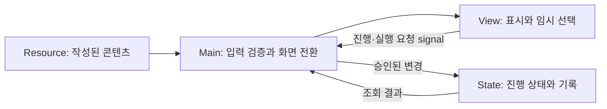

# 코드 구조와 주요 흐름

현재 구현을 읽기 위한 안내입니다. 실행 방법과 플레이 개요는 [프로젝트 README](../README.md), 과거 설계 변경은 [개발 이력](README.md#개발-이력)을 참고하세요.

## 책임 분리

View는 버튼 입력과 화면 표시를 담당합니다. 실제 실행·확정 요청은 Main으로 전달하고, Main이 현재 화면·데이터·진행 상태를 확인한 뒤 State에 기록합니다. 화면에서 선택한 것과 실제 확정된 것은 구분됩니다.

| 위치 | 역할 / 먼저 읽을 파일 |
| --- | --- |
| `scenes/main/` | 공통 GameShell, 화면 표시 영역, Campaign 연결: [main.tscn](../scenes/main/main.tscn) |
| `scripts/main/` | 화면 전환, 실험·격리 승인, 사건 연결: [main.gd](../scripts/main/main.gd) |
| `scenes/views/`, `scripts/views/` | 업무·사건·기록 화면: 공통 [flow_view.gd](../scripts/views/flow_view.gd) |
| `scripts/ui/` | 왼쪽 Navigation·R/A/N 연결: [game_shell.gd](../scripts/ui/game_shell.gd) |
| `scripts/data/` | 콘텐츠 Resource의 필드와 검증: [case_data.gd](../scripts/data/case_data.gd), [campaign_data.gd](../scripts/data/campaign_data.gd) |
| `resources/` | 실제 Case·Campaign·사건·Theme `.tres`: [test_campaign_01.tres](../resources/campaigns/test_campaign_01.tres) |
| `scripts/runtime/` | 세션 안에서 바뀌는 진행 상태와 실행 기록 |
| `scripts/read_models/` | 상태 조회·검증·종료 기록 작성에 쓰는 읽기 모델 |

Main은 여러 기능을 조율하는 큰 Script입니다. 아래 함수부터 기능별로 읽으면 전체 파일을 한꺼번에 이해할 필요가 없습니다. 전역 Autoload는 사용하지 않습니다.

## 업무 화면과 실험

`Main._ready()`가 Campaign을 검증하고 상태 객체를 만든 뒤 `_dispatch_campaign_entry()`로 첫 항목을 시작합니다. `_show_view()`는 해당 Scene을 만들고 데이터와 signal을 연결합니다.

실험 흐름은 다음과 같습니다.

1. [experiment_view.gd](../scripts/views/experiment_view.gd)에서 실험을 임시 선택합니다.
2. Run 버튼이 `experiment_execution_requested` signal로 ID를 Main에 전달합니다.
3. Main의 `_on_experiment_execution_requested()`가 실험 ID, 중복 실행, 남은 횟수 등을 확인합니다.
4. [case_runtime_state.gd](../scripts/runtime/case_runtime_state.gd)의 `try_record_experiment_execution()`이 승인된 실행 이력을 기록합니다.
5. View가 결과를 표시합니다. 환경 조건에 따른 추가 관찰은 실행 당시의 ID로 보존됩니다.

## 격리 결정과 다음 Case

[containment_view.gd](../scripts/views/containment_view.gd)의 임시 선택을 Confirm하면 Main의 `_on_containment_confirmation_requested()`가 승인 여부를 확인합니다. 확정 Room은 CaseRuntime에 기록하고, [pending_containment_state.gd](../scripts/runtime/pending_containment_state.gd)에 제출된 Case/Room을 등록합니다.

다음 Case로 넘기는 경계에서 격리 결과를 처리하고 [containment_resolution_state.gd](../scripts/runtime/containment_resolution_state.gd)에 기록합니다. 실패 후속 후보는 [failure_event_candidate_state.gd](../scripts/runtime/failure_event_candidate_state.gd)가 보유합니다. 내부 판정과 플레이어에게 실제 시설 변화·사건을 표시하는 시점은 구분됩니다.

[campaign_progress_state.gd](../scripts/runtime/campaign_progress_state.gd)는 Campaign 항목의 현재 위치와 완료 기록을 관리합니다. 다음 Case는 새 CaseRuntime으로 시작하며 Archive와 메모는 Case를 넘어 유지됩니다. 마지막 Case 이후의 player-facing Campaign 완료나 Ending은 아직 없습니다.

## 사건 대응과 업무 복귀

[incident_source.gd](../scripts/runtime/incident_source.gd)는 사건 출처를 구분하고, [incident_response_state.gd](../scripts/runtime/incident_response_state.gd)는 대응 시작·선택 확정·완료를 관리합니다.

- Campaign의 **필수 순차 사건**은 Case 사이에 배치된 항목입니다. 대응을 마치면 다음 Campaign 항목으로 진행합니다.
- **Mid-Case 사건**은 Campaign 위치를 옮기지 않고 현재 업무를 중단합니다. Main이 업무 상태를 캡처하고, `_resume_side_work()` / `_restore_side_work()`로 같은 CaseRuntime에 복귀합니다.
- 격리 실패에서 이어지는 **지연 사건**은 실패 후보와 기존 표시 조건을 사용합니다.

[interrupted_work_view_state.gd](../scripts/read_models/interrupted_work_view_state.gd)는 화면별 복원 데이터의 유효성을 확인합니다. 복원할 수 있는 필드는 화면마다 다릅니다. 특히 Profile의 사건 복귀 데이터는 focus-only이며, 일반 Navigation의 스크롤 저장과는 별도 계약입니다.

## Navigation과 R/A/N

실제 업무 단계는 `_current_stage`, 재열람 중인 화면은 `_presented_work_stage`로 구분됩니다. `_on_work_navigation_requested()`가 이동 가능 여부를 판단합니다. `_capture_work_navigation()` / `_restore_navigation_screen()`은 정상 화면 왕복의 선택·focus·scroll을 처리합니다.

| 도구 | 데이터 / 표시 |
| --- | --- |
| **R — Research Log** | Main의 `_build_research_log_snapshot()`이 현재 Case의 공개 가능한 정보를 구성하고 [research_log_view.gd](../scripts/views/research_log_view.gd)가 표시 |
| **A — Research Archive** | [research_archive_state.gd](../scripts/runtime/research_archive_state.gd)의 보관된 발견 ID를 Case별로 조회해 [목록](../scripts/views/research_archive_list_view.gd)·[상세](../scripts/views/research_archive_detail_view.gd) 화면에 표시 |
| **N — Working Hypothesis** | [working_hypothesis_state.gd](../scripts/runtime/working_hypothesis_state.gd)에 Case별 메모를 보관; Research와 같은 Scene의 별도 표시 모드 사용 |

사건 대응 중 R은 일반 현재 Case Log 대신 사건 출처 기록 화면으로 연결됩니다. 메모는 자동 정답 판정에 사용되지 않으며, 모든 기록은 현재 세션 메모리에 있습니다.

## 개발용 경로와 남은 한계

Monitoring/Result 재생과 `developer_*` 종료 API는 개발 검증 경로입니다. [developer_run_disposition_builder.gd](../scripts/read_models/developer_run_disposition_builder.gd), [run_disposition_record.gd](../scripts/runtime/run_disposition_record.gd), [run_disposition_state.gd](../scripts/runtime/run_disposition_state.gd)는 메모리 종료 기록을 검증·보존하는 코드이며 실제 Save/Ending 구현은 아닙니다.

기존의 종료 준비 Pending 처리, 여러 상태를 묶는 atomic rollback, 복원 실패 후 developer retry, Hypothesis getter 관련 과제는 남아 있습니다. 구체적인 상태와 과거 검증 범위는 Step53/54/62/70 보고서에 기록되어 있습니다. 기본 검사 방법은 [검증 안내](verification.md)를 참고하세요.
